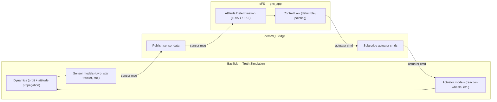

# Basilisk ↔ cFS GNC Bridge

A software-in-the-loop (SIL) integration between [Basilisk](http://hanspeterschaub.info/basilisk/)
(AVSLab's astrodynamics simulation framework) and [NASA's core Flight
System (cFS)](https://github.com/nasa/cFS). Basilisk plays the role of
"truth" — propagating orbital dynamics and simulating sensors/actuators —
while a custom cFS application implements GNC (Guidance, Navigation, and
Control) logic, the same architectural pattern used in real flight
software development and testing.

## Why this exists

This project is a hands-on demonstration of the full GNC + flight
software stack: dynamics simulation, sensor/actuator modeling, attitude
determination and control, and the real-time software architecture that
connects them — built to understand how these pieces fit together in
practice, not just in theory.

## Architecture


Basilisk propagates spacecraft dynamics and simulates sensor output
(gyro, star tracker, etc.). That data is streamed to a cFS application
over a ZeroMQ bridge. The cFS app runs attitude determination and
control as it would on real flight hardware, then sends actuator
commands (reaction wheel torques, etc.) back to Basilisk, which applies
them and continues propagation.

*Status: bridge implementation in progress. Both frameworks are
independently built and verified (see below); the ZeroMQ interface
connecting them is the current work.*

## Repository structure
bsk_cfs_gnc_bridge/
├── cfs/ # NASA cFS (git submodule)
├── cfs-apps/gnc_app/ # Custom cFS GNC application (source of truth;
│ # symlinked into cfs/apps/gnc_app for building)
├── bridge/ # ZeroMQ interface between Basilisk and cFS
├── bsk-scenarios/ # Basilisk simulation scripts (adapted from
│ # official AVSLab examples)
├── scripts/ # Build/setup automation (setup_cfs.sh, etc.)
├── docs/ # Setup logs, gotchas, architecture notes
├── results/ # Plots and logs (gitignored)
└── requirements.txt # Python dependencies (pyzmq, numpy, matplotlib)

## Setup

Basilisk and cFS are both built from source and kept **outside** this
repo (Basilisk at `~/dev/basilisk`; cFS is a git submodule inside this
repo at `cfs/`). Full setup instructions, including every issue
encountered and how it was resolved, are documented in:

- **[docs/cfs_setup.md](docs/cfs_setup.md)** — cFS build steps and the
  `gnc_app` integration walkthrough
- **[docs/basilisk_setup.md](docs/basilisk_setup.md)** — Basilisk build
  steps and version notes
- **[docs/gotchas.md](docs/gotchas.md)** — non-obvious issues and fixes,
  kept as a quick reference (e.g. cFS's auto-generated startup script,
  its hardcoded app allowlist, deprecated API calls)

### Quick start (assuming both frameworks are already built)

```bash
# Clone with submodules
git clone --recurse-submodules <repo-url>
cd bsk_cfs_gnc_bridge

# Python dependencies (activate whichever venv has Basilisk installed)
pip install -r requirements.txt

# Build and run cFS
cd cfs
make native_std.prep
make native_std.install
./build-native_std/exe/cpu1/core-cpu1

# Run a Basilisk scenario
cd ../bsk-scenarios
python3 scenarioBasicOrbit.py
```

## Current status

- ✅ cFS builds (`native_std` config) and boots successfully
- ✅ Custom `gnc_app` compiles, registers, and loads at boot alongside
  stock cFS apps
- ✅ Basilisk (v2.10.2) builds from source and runs orbit propagation
  scenarios
- 🔲 ZeroMQ bridge connecting Basilisk sensor output to `gnc_app`
- 🔲 Attitude determination (TRIAD/EKF) implemented in `gnc_app`
- 🔲 Control law (detumble/pointing) implemented in `gnc_app`
- 🔲 Closed-loop validation against Basilisk-native FSW baseline

## License

TBD
